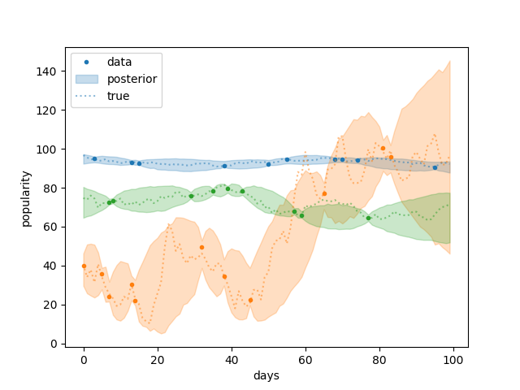
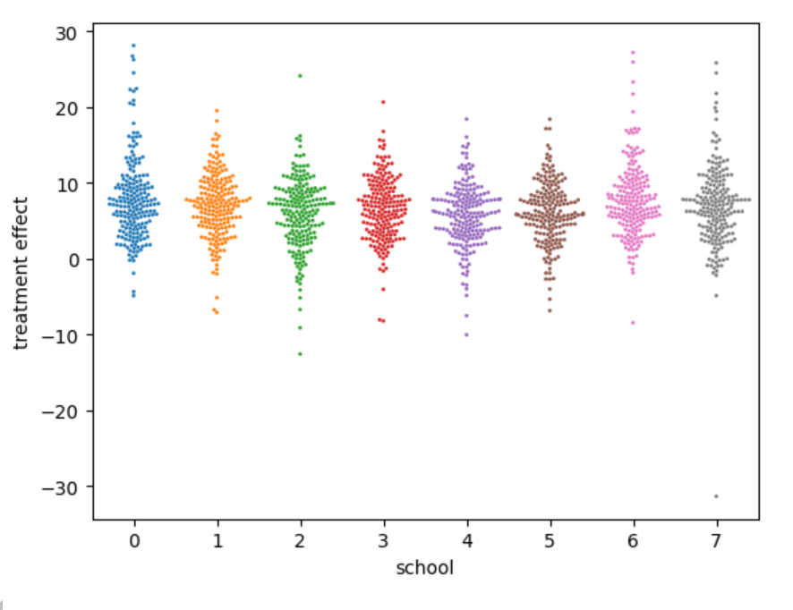

Practically, Pangolin aims to be **the world's friendliest probabilistic programming language**. As a
research project, it is a quest for ultimate perfection in the art of constructing and manipulating expression graphs.

## Links

* [Installation](INSTALL.md) (or `pip install pangolin`)
* [API docs](https://justindomke.github.io/pangolin/)
* [Changelog](CHANGELOG.md)

## Mini-tutorial (Why use Pangolin?)

Because it's easy. Because you barely need to learn any new abstractions to start using it. Here's an example of building a polling model, generating synthetic data, and then doing posterior inference:

```python
import pangolin
from pangolin import interface as pi
from matplotlib import pyplot as plt
import numpy as np

# setup
num_candidates = 3
num_days = 100
num_polls = 30

candidates = np.random.randint(0, num_candidates, num_polls)
days       = np.random.randint(0, num_days, num_polls)

# model
approval_std = [pi.lognormal(0, 1) for _ in range(num_candidates)]
poll_std     = [pi.lognormal(0, 1) for _ in range(num_candidates)]

approval = [[None] * num_days for _ in range(num_candidates)]

for c in range(num_candidates):
    for d in range(num_days):
        if d == 0:
            prev = pi.uniform(0,100)
        else:
            prev = approval[c][d-1]
        approval[c][d] = pi.normal(prev, approval_std[c])

polls = [None for _ in range(num_polls)]

for i in range(num_polls):
    c = candidates[i]
    d = days[i]
    polls[i] = pi.normal(approval[c][d], poll_std[c])

# synthetic data
[approval_true, polls_obs] = pangolin.jax_backend.ancestor_sample([approval, polls])

# posterior inference
approval_samps = pangolin.blackjax.sample(approval, polls, polls_obs, num_samples = 1000)

# plot
plt.figure()
for c in range(num_candidates):
    where = candidates == c
    l = plt.plot(days[where], np.array(polls_obs)[where], '.', label='data' if c==0 else None)
    color = l[0].get_color()

    lo = np.percentile(approval_samps[c], 2.5, axis=1)
    hi = np.percentile(approval_samps[c], 97.5, axis=1)
    plt.fill_between(np.arange(num_days), lo, hi, color=color, alpha=0.25,
        label='posterior' if c==0 else None)

    plt.plot(approval_true[c], ':', alpha=0.5, label='true' if c==0 else None, color=color)

plt.xlabel('days')
plt.ylabel('popularity')
plt.legend();
```




Almost all the work is done using normal Python abstractions. But if you have a lot of data and/or a GPU, you'll likely want to use vectorized instructions. Pangolin offers an exceptionally ergonomic way to do that which *does not rely on broadcasting tricks*:

```python
# create model
candidates_rv = pi.constant(candidates)
days_rv       = pi.constant(days)
approval_std = pi.lognormal(np.zeros(num_candidates), 1)
poll_std     = pi.lognormal(np.zeros(num_candidates), 1)

@pi.loop
def approval(prev, c = num_candidates, d = pi.seq(num_days)):
    if d is None:
        return pi.uniform(0, 100)
    else:
        return pi.normal(prev[c,d-1], approval_std[c])

@pi.loop
def polls(i = num_polls):
    c = candidates_rv[i]
    d = days_rv[i]
    
    return pi.normal(approval[c,d], poll_std[c])

# synthetic data
(approval_true, polls_obs) = pangolin.jax_backend.ancestor_sample([approval, polls])

# posterior inference
approval_samps = pangolin.blackjax.sample(approval, polls, polls_obs, num_samples = 1000)
```

Inference on this model is just as efficient as inference on a density expressed in raw JAX using combinations of `vmap` or `scan`. Don't believe it? Don't like how magical that code looks? Well, you can always look at the internal representation:

```python
pi.print_upstream(polls, locals())
```

```text
shape    | statement
-------- | ---------
()       | a = 0
()       | b = 100
(3,)     | c ~ vmap(uniform, [None, None], 3)(a, b)
(3,)     | d = [0. 0. 0.]
()       | e = 1
(3,)     | approval_std ~ vmap(lognormal, [0, None], 3)(d, e)
(3,)     | f = [0 1 2]
(3, 100) | approval ~ vmap(scan(composite(3, [index, normal], [[1, 2], [0, 3]]), 100, [None, None]), [0, None, 0], 3)(c, approval_std, f)
(30,)    | candidates_rv = [2 0 ... 0 0]
(30,)    | days_rv = [61 44 ... 45 39]
(30,)    | g = vmap(index, [None, 0, 0], 30)(approval, candidates_rv, days_rv)
(3,)     | h = [0. 0. 0.]
()       | i = 1
(3,)     | poll_std ~ vmap(lognormal, [0, None], 3)(h, i)
(30,)    | j = vmap(index, [None, 0], 30)(poll_std, candidates_rv)
(30,)    | polls ~ vmap(normal, [0, 0], 30)(g, j)
```

(If you prefer, you can also write it using `vmap` and `scan` instead of `loop`.)

Mathematically, the internal representation is just a directed graph of random variables (RVs). Each RV has an operation (Op) and a list of parents. Ops compose with container Ops like `VMap` and `Scan`. That's pretty much all there is to it. This is designed to be simple, explicit. Hence, the [JAX backend](https://github.com/justindomke/pangolin/blob/main/pangolin/jax_backend.py) is a single 1000-line long file. It has no idea that the ergonomic interface layer even exists.

## Goals

At a high level, Pangolin has two goals:

1. To make things simple for end users who just want to do inference, while still taking full advantage of modern hardware (GPUs).

2. To make things simple for *researchers* who want to develop new inference algorithms, develop new ways of specifying probabilistic models, share models between different backends (JAX / PyTorch), benchmark inference algorithms written in different languages, etc.

## Goals (for end users)

For end-users, Pangolin tries to provide an interface that is simple and explicit. In particular:

* **Gradual enhancement.** Easy things should be *really* easy. More complex features should be easy to discover. Steep learning curves should be avoided.

* **Small API surface.** The set of abstractions the user needs to learn should be as small as possible. 

* **Explicitness.** Many modern PPLs (e.g. Pyro / NumPyro / PyMC / Orxy) lean heavily on NumPy's broadcasting semantics. This looks very nice in simple cases, but becomes confusing in complex cases. In Pangolin, by default, only a very limited amount of broadcasting is allowed. (Though this is configurable.) Instead of implicit broadcasting, in Pangolin, users should use an explicit [`vmap`](https://justindomke.github.io/pangolin/interface.html#pangolin.interface.vmap) transformation, inspired by [`jax.vmap`](https://docs.jax.dev/en/latest/_autosummary/jax.vmap.html). If you see `x = vmap(normal, [0, None])(a, b)` or `x = vfor(lambda i: normal(a[i], b))`, that means that `a` *must* be one-dimensional, `b` *must* be scalar, and `x` *must* be one-dimensional. Similarly, many modern PPLs inherit their indexing behavior from NumPy, which combines broadcasting with lots of other special cases and is [legendarily complicated](https://numpy.org/doc/stable/user/basics.indexing.html#advanced-indexing). Pangolin uses ultra-simple and ultra-legible [full-orthogonal indexing](https://justindomke.github.io/pangolin/interface.html#pangolin.interface.oindex). If you see `u = z[x,y]` then you know that `z.ndim == 2` and `u.ndim == x.ndim + y.ndim` *always*. More complex cases can still be handled with `vmap`. All this code more self-documenting and predictable.

* **Graceful interop.** As much as possible, the system should feel like a natural part of the broader ecosystem, rather than a "new language". In particular, Pangolin tries to avoid several oddities common in other modern PPLs:

  * No "sample" statements or string labels. In Pyro or NumPyro you write `z = sample('z', Normal(0, 1))`. In Pangolin you just write `z = normal(0, 1)`. If you want to refer to `z` later, you use a reference to the resulting `RV` object, e.g. by writing `E(z)` to get the expected value of `z`. You can organize random variables into (recursive) lists or tuples or dictionaries however you want. For example, if `x` `y`, and `z` are scalar `RV`s, then `E([x, {'alice': y, 'bob': z}])` will return a list where the first element is a float, and the second element is a dictionary with keys `'alice'` and `'bob'`, each of which map to a float.

  * No attaching data to random variables with "obs" statements. In Pyro or NumPyro or PyMC, if a random variable `x` is observed, you need to write something like `x = sample('x', Normal(z, 1), obs=x_obs)`. In Pangolin, you always just write `x = normal(z, 1)`. You decide if you want to condition on `z` at the inference stage, e.g. by using `E(z, x, x_obs)` to estimate the expected value of `z` conditioning on `x=x_obs`. This is how it works in math, after all.

  * No "model" objects. In most (all?) other PPLs, you create a "model" object, and then you query it to exact information about random variables. In Pangolin, you just manipulate random variables, with no additional layer of abstraction. This is also how it works in math.

* In Pangolin you can see the internal representation. After building a model, you can call `print_upstream` to see the internal representation, with the parents and shapes of all random variables.

## Goals (for researchers)

Pangolin is extremely modular. It's build around a simple [internal representation](https://justindomke.github.io/pangolin/ir.html) (IR) in which there are only two types of objects: An `Op` represents a conditional distribution or deterministic function, while an `RV` contains a single `Op` and a list of parent `RV`. Primitives to make evaluation efficient on modern hardware (e.g. `VMap` or `Scan`) wrap individuals `Op`s. That's basically all there is to it.

All other parts of Pangolin are decoupled: They only depend on the IR, not on each other. For example, the [interface](https://justindomke.github.io/pangolin/interface.html) offers a friendly way for users to specify models, with optional broadcasting, program transformations, and so on. Internally, this is quite complicateded. But it just produces models in the IR. The different backends only look at the IR, and don't even know that the interface layer exists.

This makes many things easy that are typically quite difficult in modern PPLs:

* Say you want to create a new inference algorithm that programatically inspects the model. That's easy, because the IR is just a static graph of random variables.

* Say you want to create a probabilistic model and share it with collaborators, some of whom use JAX and some of whom use PyTorch. That's fine. The former group can use the [JAX backend](pangolin/jax_backend.py) while the latter group use the [torch backend](pangolin/torch_backend.py).

* Say you want to create a new "backend" that will do inference using a different array computing framework instead of JAX or PyTorch. This is pretty easy. The [torch backend](pangolin/torch_backend.py) is around 1000 lines. The [JAX backend](pangolin/jax_backend.py) is around 500 lines. The [blackjax interface](pangolin/blackjax.py) is 400 lines.

* Say you hate Pangolin's interface. That's fine. Make a new one! As long as you produce models into the Pangolin IR, you can still use the existing backends.

* In the future, we hope to make the IR language independent, so interfaces and backends could be in other languages, e.g. R or Julia. (This is possible in principle now, but could be made easier.)

## Examples and comparisons

### Simple "probabilistic calculator"

If `z ~ normal(0,2)` and `x ~ normal(0,6)` then what is `E[z | x = -10]`?

```python
from pangolin import interface as pi
from pangolin.blackjax import E

z = pi.normal(0,2)
x = pi.normal(x,6)
print(E(z, x, -10.0))
```

Here is the same model in other PPLs. (Or see [calculator-ppls.ipynb](demos/calculator-ppls.ipynb).)

<details markdown="1" name="calculator">
<summary>PyMC</summary>

```python
import pymc as pm

with pm.Model():
    z = pm.Normal('z', 0, 2)
    x = pm.Normal('x', z, 6, observed=-10)
    trace = pm.sample(chains=1)
    z_samps = trace.posterior['z'].values
    print(np.mean(z_samps))
```

</details>


<details markdown="1" name="calculator">
<summary>Pyro</summary>

```python
import pyro
import torch

def model():
    z = pyro.sample('z', pyro.distributions.Normal(0, 2))
    x = pyro.sample('x', pyro.distributions.Normal(z, 6), obs=torch.tensor(-10.0))

nuts_kernel = pyro.infer.mcmc.NUTS(model)
mcmc = pyro.infer.mcmc.MCMC(nuts_kernel, warmup_steps=500, num_samples=1000, num_chains=1)
mcmc.run()
z_samps = mcmc.get_samples()['z'].numpy()
print(np.mean(z_samps))
```

</details>


<details markdown="1" name="calculator">
<summary>NumPyro</summary>

```python
import numpyro
import jax
import jax.numpy as jnp

def model():
    z = numpyro.sample('z', numpyro.distributions.Normal(0, 2))
    x = numpyro.sample('x', numpyro.distributions.Normal(z, 6), obs=-10)

nuts_kernel = numpyro.infer.NUTS(model)
mcmc = numpyro.infer.MCMC(nuts_kernel, num_warmup=500, num_samples=1000, num_chains=1)
mcmc.run(jax.random.PRNGKey(42))
z_samps = mcmc.get_samples()['z']
print(np.mean(z_samps))
```

</details>


<details markdown="1" name="calculator">
<summary>JAGS</summary>

```python
import pyjags

model_code = """
model {
  z ~ dnorm(0, 1/2^2)
  x ~ dnorm(z, 1/6^2)
}
"""

model = pyjags.Model(
    code=model_code,
    data={'x': -10},
    chains=1,
    adapt=500
)

samples = model.sample(1000, ['z'])
z_samps = samples['z'].flatten()
print(np.mean(z_samps))
```

</details>

<details markdown="1" name="calculator">
<summary>Stan</summary>

```python
import cmdstanpy
import tempfile
from pathlib import Path

stan_code = """
data {
  real x;
}
parameters {
  real z;
}
model {
  z ~ normal(0, 2);
  x ~ normal(z, 6);
}
"""

with tempfile.TemporaryDirectory() as tmpdir:
    stan_file = Path(tmpdir) / "calculator_model.stan"
    stan_file.write_text(stan_code)

    model = cmdstanpy.CmdStanModel(stan_file=str(stan_file))

    fit = model.sample(
        data={'x': -10.0},
        chains=1,
        iter_warmup=500,
        iter_sampling=1000,
        seed=42
    )
    z_samps = fit.stan_variable('z')

    print(np.mean(z_samps))
```

</details>

### Beta-Bernoulli model

This is arguably the simplest Bayesian model. If you've seen a bunch of coinflips from a bent coin, what is the true bias? To start, generate synthetic data.

```python
# synthetic data
import numpy as np
np.random.seed(67)
z_true = 0.7
N = 20
x_obs = np.random.binomial(1, z_true, N)

# create model
import pangolin
from pangolin import interface as pi
z = pi.beta(2,2)
x = pi.vmap(pi.bernoulli, None, N)(z)

# do inference
z_samps = pangolin.blackjax.sample(z, x, x_obs) # p(z | x = x_obs)

# plot
import seaborn as sns
sns.histplot(z_samps, binrange=[0,1])
```

Here is the same model in other PPLs. (Or see [beta-bernoulli-ppls.ipynb](demos/beta-bernoulli-ppls.ipynb).)


<details markdown="1" name="bb">
<summary>PyMC</summary>

```python
import pymc as pm

with pm.Model() as coin_model:
    z = pm.Beta('z', alpha=2, beta=2)
    x = pm.Bernoulli('x', z, observed=x_obs)
    trace = pm.sample(chains=1)
    z_samps = trace.posterior['z'].values
    print(np.mean(z_samps), np.std(z_samps))
```

</details>


<details markdown="1" name="bb">
<summary>Pyro</summary>

```python
import pyro
import torch

x_obs_torch = torch.tensor(x_obs, dtype=torch.float)

def model():
    z = pyro.sample('z', pyro.distributions.Beta(2.0, 2.0))
    with pyro.plate('N', N):
        x = pyro.sample('x', pyro.distributions.Bernoulli(z), obs=x_obs_torch)

nuts_kernel = pyro.infer.mcmc.NUTS(model)
mcmc = pyro.infer.mcmc.MCMC(nuts_kernel, warmup_steps=500, num_samples=1000, num_chains=1)
mcmc.run()
z_samps = mcmc.get_samples()['z'].numpy()
print(np.mean(z_samps), np.std(z_samps))
```

</details>


<details markdown="1" name="bb">
<summary>NumPyro</summary>

```python
import numpyro
import jax
import jax.numpy as jnp

def model():
    z = numpyro.sample('z', numpyro.distributions.Beta(2.0, 2.0))
    with numpyro.plate('data', N):
        x = numpyro.sample('x', numpyro.distributions.Bernoulli(z), obs=x_obs)

nuts_kernel = numpyro.infer.NUTS(model)
mcmc = numpyro.infer.MCMC(nuts_kernel, num_warmup=500, num_samples=1000, num_chains=1)
mcmc.run(jax.random.PRNGKey(42))
z_samps = mcmc.get_samples()['z']
print(np.mean(z_samps), np.std(z_samps))
```

</details>


<details markdown="1" name="bb">
<summary>JAGS</summary>

```python
import pyjags

model_code = """
model {
  z ~ dbeta(2, 2)
  for (i in 1:N) {
    x[i] ~ dbern(z)
  }
}
"""

model = pyjags.Model(
    code=model_code,
    data={'N': N, 'x': x_obs.tolist()},
    chains=1,
    adapt=500
)

samples = model.sample(1000, ['z'])
z_samps = samples['z'].flatten()
print(np.mean(z_samps), np.std(z_samps))
```

</details>


<details markdown="1" name="bb">
<summary>Stan</summary>

```python
import cmdstanpy
import tempfile
from pathlib import Path

stan_code = """
data {
  int<lower=0> N;
  array[N] int<lower=0, upper=1> x;
}
parameters {
  real<lower=0, upper=1> z;
}
model {
  z ~ beta(2, 2);
  x ~ bernoulli(z);
}
"""

with tempfile.TemporaryDirectory() as tmpdir:
    stan_file = Path(tmpdir) / "coin_model.stan"
    stan_file.write_text(stan_code)

    model = cmdstanpy.CmdStanModel(stan_file=str(stan_file))

    fit = model.sample(
        data={'N': N, 'x': x_obs},
        chains=1,
        iter_warmup=500,
        iter_sampling=1000,
        seed=42
    )
    z_samps = fit.stan_variable('z')
    print(np.mean(z_samps), np.std(z_samps))
```

</details>


### Eight-schools

Bayesian inference on the classic 8-schools model:

```python
# setup
import numpy as np
N = 8
stddevs = np.array([15, 10, 16, 11, 9, 11, 10, 18])
x_obs = np.array([28, 8, -3, 7, -1, 1, 18, 12])

# inference
import pangolin
from pangolin import interface as pi

mu  = pi.normal(0,10)
tau = pi.lognormal(0,5)
z   = pi.vmap(pi.normal, None, N)(mu, tau)
x   = pi.vmap(pi.normal)(z, stddevs)
z_samps = pangolin.blackjax.sample(z, x, x_obs, niter=10000)

# plot
import numpy as np
import seaborn as sns
from matplotlib import pyplot as plt
sns.swarmplot(np.array(z_samps)[:,::50].T,s=2,zorder=0)
plt.xlabel('school')
plt.ylabel('treatment effect')
```



Here is the same model in other PPLs. (Or see [eight-schools-ppls.ipynb](demos/eight-schools-ppls.ipynb).)

<details markdown="1" name="8schools">
<summary>PyMC</summary>

```python
import pymc as pm

with pm.Model():
    mu = pm.Normal('mu', 0, 10)
    tau = pm.LogNormal('tau', 0, 5)
    z = pm.Normal('z', mu, tau, size=N)
    x = pm.Normal('x', z, stddevs, observed=x_obs)

    trace = pm.sample(draws=10000, chains=1)
    z_samps = trace.posterior['z'].values[0,:,:]
```

</details>

<details markdown="1" name="8schools">
<summary>Pyro</summary>

```python
import pyro
import torch

stddevs_torch = torch.tensor(stddevs)
x_obs_torch = torch.tensor(x_obs)

def model():
    mu = pyro.sample('mu', pyro.distributions.Normal(0, 10))
    tau = pyro.sample('tau', pyro.distributions.LogNormal(0, 5))
    with pyro.plate('N', N):
        z = pyro.sample('z', pyro.distributions.Normal(mu, tau))
        x = pyro.sample('x', pyro.distributions.Normal(z, stddevs_torch), obs=x_obs_torch)

nuts_kernel = pyro.infer.mcmc.NUTS(model)
mcmc = pyro.infer.mcmc.MCMC(nuts_kernel, warmup_steps=500, num_samples=1000, num_chains=1)
mcmc.run()
z_samps = mcmc.get_samples()['z'].numpy()
```

</details>


<details markdown="1" name="8schools">
<summary>NumPyro</summary>

```python
import numpyro
import jax

stddevs_torch = torch.tensor(stddevs)
x_obs_torch = torch.tensor(x_obs)

def model():
    mu = numpyro.sample('mu', numpyro.distributions.Normal(0, 10))
    tau = numpyro.sample('tau', numpyro.distributions.LogNormal(0, 5))
    with numpyro.plate('N',N):
        z = numpyro.sample('z', numpyro.distributions.Normal(mu, tau))
        x = numpyro.sample('x', numpyro.distributions.Normal(z, stddevs), obs=x_obs)

nuts_kernel = numpyro.infer.NUTS(model)
mcmc = numpyro.infer.MCMC(nuts_kernel, num_warmup=500, num_samples=1000, num_chains=1)
mcmc.run(jax.random.PRNGKey(42))
z_samps = mcmc.get_samples()['z']
```

</details>

<details markdown="1" name="8schools">
<summary>JAGS</summary>

```python
import pyjags

model_code = """
model {
  mu ~ dnorm(0, 1/10^2)
  tau ~ dlnorm(0, 1/5^2)
  for (i in 1:N) {
    z[i] ~ dnorm(mu, 1/tau^2)
    x[i] ~ dnorm(z[i], 1/stddevs[i]^2)
  }
}
"""

model = pyjags.Model(
    code=model_code,
    data={'N': N, 'stddevs': stddevs.tolist(), 'x': x_obs.tolist()},
    chains=1,
    adapt=5000
)

samples = model.sample(100000, ['z'])
z_samps = np.array(samples['z'])[:,:,0].T
```

</details>

<details markdown="1" name="8schools">
<summary>Stan</summary>

```python
import cmdstanpy
import tempfile
from pathlib import Path

stan_code = """
data {
  int<lower=0> N;
  array[N] real x;
  array[N] real stddevs;
}
parameters {
  real mu;
  real<lower=0> tau;
  array[N] real z;
}
model {
  mu ~ normal(0, 10);
  tau ~ lognormal(0, 5);
  for (i in 1:N) {
    z[i] ~ normal(mu, tau);
    x[i] ~ normal(z[i], stddevs[i]);
  }
}
"""

with tempfile.TemporaryDirectory() as tmpdir:
    stan_file = Path(tmpdir) / "8schools_model.stan"
    stan_file.write_text(stan_code)

    model = cmdstanpy.CmdStanModel(stan_file=str(stan_file))

    fit = model.sample(
        data={'N': N, 'stddevs': stddevs, 'x': x_obs},
        chains=1,
        iter_warmup=500,
        iter_sampling=1000,
        seed=42
    )
    z_samps = fit.stan_variable('z')
```

</details>

### More examples

For more examples, take a look at the [demos](demos/). Here's a recommended order:

* [IR.ipynb](demos/ir.ipynb) demonstrates pangolin's internal representation of probabilistic models.
* [interface.ipynb](demos/interface.ipynb) demonstrates pangolin's friendly interface and what internal representation it produces.
* [8schools.ipynb](demos/8schools.ipynb) is the classic 8-schools model.
* [regression.ipynb](demos/regression.ipynb) is Bayesian linear regression.
* [timeseries.ipynb](demos/timeseries.ipynb) is a simple timeseries model.
* [scan.ipynb](demos/scan.ipynb) is a Kalman-filter-esque model.
* [GP-regression.ipynb](demos/GP-regression.ipynb) is Gaussian Process regression.
* [1PL.ipynb](demos/1PL.ipynb) is a simple item-response-theory model.
* [2PL.ipynb](demos/2PL.ipynb) is a slightly more complex item-response-theory model.

## See also

An earlier version of Pangolin is available and based on much the same ideas, except only supporting JAGS as a backend. It can be found with documentation, in the 
[`pangolin-jags`](pangolin-jags) directory.
